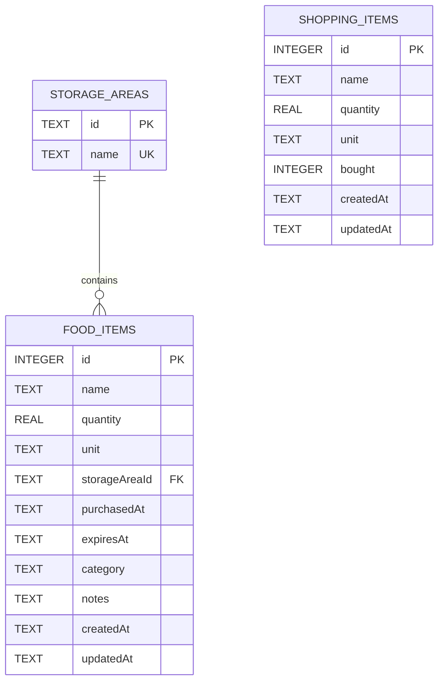
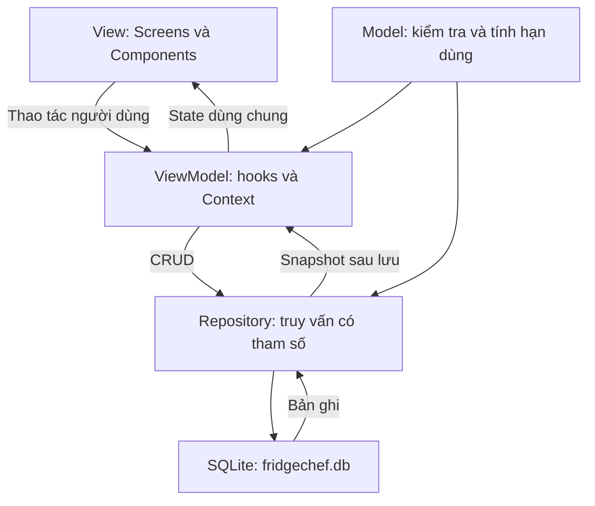

# FridgeChef — Tuần 3: Cơ sở dữ liệu và kiến trúc

## 1. Kế hoạch và phạm vi

Mục tiêu: thay dữ liệu thực phẩm giả bằng dữ liệu lưu thật, có ERD, kiến trúc rõ ràng và demo được CRUD.

| Thứ tự | Công việc | Sản phẩm kiểm tra |
|---|---|---|
| 1 | Chọn lưu trữ, chốt phạm vi | SQLite, một tủ lạnh trên một thiết bị |
| 2 | Thiết kế ERD và các trường | Ba bảng, khóa chính, khóa ngoại, ràng buộc |
| 3 | Tách MVVM và repository | Màn hình không gọi SQL trực tiếp |
| 4 | Thêm, đọc, sửa, xóa thực phẩm | Form có kiểm tra dữ liệu; lưu qua lần mở lại |
| 5 | Đồng bộ trang chủ và cảnh báo | Dùng cùng nguồn dữ liệu với tủ lạnh |
| 6 | Lưu danh sách đi chợ | CRUD, trạng thái đã mua, chuyển vào tủ lạnh |
| 7 | Kiểm thử và báo cáo | Kiểm thử SQL thật, kịch bản demo, giới hạn rõ ràng |

Các mục trên đã được viết trong mã nguồn. Kiểm thử tự động dùng SQLite trên Node; chạy nghiệm thu giao diện trên Android là bước riêng trong mục 8.

## 2. Lựa chọn lưu trữ

**Bản tuần 3 sử dụng SQLite qua expo-sqlite tương thích Expo SDK 52.** Đề cho phép lưu cục bộ. Phương án này không cần tài khoản cloud, dùng được khi không có mạng và thể hiện trực tiếp các bảng, quan hệ và SQL.

README ban đầu dự kiến Firebase. Đây là thay đổi lựa chọn cho bản tuần 3, không phải đã tích hợp Firebase. Khi nhóm cần tài khoản hoặc dùng chung tủ lạnh giữa nhiều máy, có thể bổ sung Firebase Authentication và thay repository bằng Firestore/API; vẫn cần thiết kế quyền sở hữu, đồng bộ và chuyển dữ liệu.

Phạm vi hiện tại là **một tủ lạnh trên thiết bị**, không có tài khoản thật. Không tạo bảng người dùng hoặc mật khẩu giả. Giữ màn hình đăng nhập gốc của nhóm, kèm chú thích rõ đây là demo cục bộ chưa xác thực. Nút đăng nhập chỉ mở phiên demo; các email không tạo ra các vùng dữ liệu khác nhau.

Dữ liệu được giữ trong file `fridgechef.db` của ứng dụng qua các lần đóng/mở. Gỡ ứng dụng, xóa dữ liệu hoặc xóa máy ảo có thể làm mất dữ liệu. Trong Expo Go, dữ liệu nằm trong vùng lưu trữ do Expo Go quản lý, không phải một máy chủ cloud.

## 3. ERD



- Một khu vực lưu trữ có nhiều thực phẩm; một thực phẩm thuộc đúng một khu vực.
- `shopping_items` là danh sách chờ mua độc lập. Sau khi chuyển, tạo thực phẩm và xóa mục mua sắm trong cùng transaction; không có khóa ngoại bền vững giữa hai bảng này.
- Không gộp các lần mua cùng tên: chúng có thể có hạn sử dụng khác nhau, nên mỗi lần nhập tạo một bản ghi riêng.

### Từ điển dữ liệu

| Bảng | Trường | Kiểu / quy tắc |
|---|---|---|
| storage_areas | id | TEXT, PK; `cool`, `frozen`, `dry` |
| storage_areas | name | TEXT, NOT NULL, UNIQUE; Ngăn mát / Ngăn đông / Đồ khô |
| food_items | id | INTEGER, PK, AUTOINCREMENT |
| food_items | name | TEXT, bắt buộc, sau trim dài 1–100 ký tự |
| food_items | quantity | REAL, lớn hơn 0 và không quá 1.000.000 |
| food_items | unit | TEXT, bắt buộc, dài 1–20 ký tự |
| food_items | storageAreaId | TEXT, FK → storage_areas.id; ON DELETE RESTRICT |
| food_items | purchasedAt | TEXT dạng YYYY-MM-DD; ngày lịch địa phương |
| food_items | expiresAt | TEXT dạng YYYY-MM-DD; không trước purchasedAt |
| food_items | category | TEXT, mặc định other; vegetables / fruit / protein / dairy / pantry / other |
| food_items | notes | TEXT, mặc định rỗng, tối đa 500 ký tự |
| food_items | createdAt, updatedAt | TEXT, thời điểm UTC do SQLite ghi |
| shopping_items | id | INTEGER, PK, AUTOINCREMENT |
| shopping_items | name, quantity, unit | Cùng quy tắc với food_items |
| shopping_items | bought | INTEGER, chỉ 0 hoặc 1, mặc định 0 |
| shopping_items | createdAt, updatedAt | TEXT, thời điểm UTC do SQLite ghi |

Ngày mua/hạn dùng lưu dưới dạng ngày ISO để so sánh, sắp xếp đúng; UI nhập/hiển thị `dd/MM/yyyy`. Không ép các ngày này sang UTC vì có thể lệch ngày theo múi giờ. SQL dùng tham số `?`, không nối chuỗi nội dung người dùng.

Các cột `status`, `daysLeft`, `quantityText`, `code`, `area` là dữ liệu trình bày được tính khi đọc, không lưu lặp vào DB.

Quy ước cảnh báo: hạn dùng trước hôm nay → quá hạn; bằng hôm nay đến 3 ngày tới → sắp hết hạn; từ 4 ngày trở lên → còn hạn. Tính theo ngày lịch, không lấy chênh lệch số giờ. Trạng thái cập nhật khi trở lại app và mỗi phút khi app đang mở. Đây là quy ước hiển thị của bài tập, không phải đánh giá an toàn thực phẩm.

Schema bật foreign keys, WAL, có index theo ngăn và hạn dùng. `PRAGMA user_version` quản lý phiên bản; tạo bảng và cập nhật phiên bản trong cùng transaction. Khởi động lại không xóa hoặc tự đổ lại dữ liệu mẫu. Schema v2 thêm category và notes bằng ALTER TABLE trong transaction; bản ghi v1 giữ nguyên và nhận giá trị mặc định.

## 4. Kiến trúc MVVM



| Tầng | Tệp / thư mục | Trách nhiệm |
|---|---|---|
| View | src/screens/, src/components/ | Hiển thị, nhập liệu, điều hướng, xác nhận xóa |
| ViewModel | src/viewmodels/FridgeProvider.js | Khởi tạo DB, giữ dữ liệu chung, reload sau mutation, trạng thái bận/lỗi |
| ViewModel | src/viewmodels/useFoodFormViewModel.js | State form thêm/sửa, kiểm tra dữ liệu, gọi lưu |
| ViewModel | src/viewmodels/useShoppingViewModel.js | Form đi chợ, trạng thái modal, thao tác mua/chuyển |
| Model | src/models/food.js | Kiểu dữ liệu theo hàm, kiểm tra tên/số lượng/ngày, tính cảnh báo |
| Truy cập dữ liệu | src/repositories/fridgeRepository.js | CRUD SQL, tuần tự hóa ghi, transaction chuyển món |
| Schema | src/database/schema.js | Tạo bảng, index, khóa ngoại, migration |
| Navigation | src/navigation/ | Stack và bốn tab |

Các màn hình không import expo-sqlite hay viết SQL. Context chia sẻ state giữa trang chủ, tủ lạnh, chi tiết, cảnh báo và đi chợ; sau lưu thành công, nạp snapshot từ DB rồi cập nhật tất cả màn hình. Trang chi tiết giữ `foodId`, không giữ bản sao thực phẩm có thể bị cũ sau chỉnh sửa.

## 5. Các thao tác đã triển khai

| Chức năng | Repository | Hành vi |
|---|---|---|
| Đọc danh sách | getSnapshot | Lấy thực phẩm theo hạn dùng; danh sách mua theo trạng thái |
| Thêm thực phẩm | saveFood không có id | Kiểm tra rồi INSERT |
| Sửa thực phẩm | saveFood có id | UPDATE; báo lỗi nếu bản ghi không còn tồn tại |
| Xóa thực phẩm | deleteFood | Có hộp xác nhận trên UI; DELETE theo id |
| CRUD đi chợ | saveShopping, deleteShopping | Lưu tên, số lượng, đơn vị |
| Đánh dấu đã mua | setBought | Cập nhật bought trong DB |
| Chuyển đã mua | moveBoughtToFridge | Chọn ngăn/ngày/hạn dùng, INSERT và DELETE nguyên tử |
| Dữ liệu thử | addDemoFoods | Chỉ tạo khi bấm nút ở tủ lạnh trống; ngày tương đối với hôm nay |

Theo yêu cầu nâng cấp màn thêm/sửa, form thực phẩm nay tách số lượng và đơn vị; có nút tăng/giảm, chọn ngày bằng lịch, gợi ý tên, nhóm thực phẩm và ghi chú tùy chọn. Hạn dùng mặc định trống, yêu cầu người dùng chọn theo sản phẩm. Các màn hình chính khác giữ bố cục gốc. Danh sách đi chợ giữ thanh tiến độ và nút chuyển ở đáy; menu dấu ba chấm bổ sung thao tác sửa/xóa, modal dùng cho thêm/sửa và chọn ngày khi chuyển.

Form kiểm tra tên rỗng, đơn vị rỗng, số lượng không hợp lệ, ngày không tồn tại như 31/02, định dạng ngày, hạn dùng trước ngày mua. Chấp nhận số thập phân có dấu phẩy. Dữ liệu form giữ nguyên khi lưu lỗi. Nút lưu bị khóa khi đang xử lý để tránh bấm lặp.

Khi chuyển nhiều món, người dùng nhập số lượng thực mua và chọn ngăn, ngày mua, hạn dùng riêng cho từng món. Có thể chọn “Cất món này vào tủ lạnh” trong menu để chuyển riêng một món đã mua; các món đã mua khác được giữ nguyên. Không tự suy đoán hạn sử dụng. Khi một thao tác trong quá trình chuyển lỗi, transaction rollback cả việc thêm thực phẩm lẫn xóa danh sách mua.

## 6. Cách chạy

Trong terminal tại thư mục dự án, dừng Expo cũ bằng Ctrl+C rồi chạy:

```powershell
npm install
npx expo start --clear
```

Mở máy ảo Android rồi nhấn `a` trong terminal. Dự án vẫn dùng Expo SDK 52; dùng Expo Go tương thích SDK này. `expo-sqlite` được khai báo bản `~15.1.4` theo bundledNativeModules.json của Expo SDK đang cài. Không nâng Expo hoặc cài phiên bản expo-sqlite mới nhất tùy ý.

Các tham chiếu đến ảnh icon/splash/favicon không có trong repository đã được bỏ khỏi app.json để tránh lỗi asset; có thể bổ sung bộ ảnh thương hiệu sau.

## 7. Kiểm thử tự động

Yêu cầu Node 22.13+ (khuyên dùng Node 24, máy hiện tại đã có). Đây là yêu cầu của bộ kiểm thử dùng `node:sqlite`, không phải của mã SQL trên Android.

```powershell
npm test
npm run check:source
```

Kiểm thử repository chạy SQL trên cơ sở dữ liệu SQLite thật qua adapter có cùng chữ ký async với Expo; dùng chính các file schema/model/repository của ứng dụng. Kiểm tra đóng/mở lại DB, CRUD, dữ liệu đã xóa không tái xuất hiện, FK/CHECK, SQL chứa dấu nháy, giữ trạng thái đã mua, rollback khi lỗi giữa transaction, chuyển trùng, và phục hồi hàng đợi sau lỗi.

Kiểm thử model kiểm tra năm nhuận, ngày sai, định dạng ngày, số lượng và các ranh giới cảnh báo. `check:source` biên dịch Babel toàn bộ source, kiểm tra import cục bộ, dependency khai báo và đường dẫn asset. Các bước này không thay thế kiểm tra native module, bundle và UI trên Android.

## 8. Kịch bản demo nghiệm thu trên Android

| Bước | Thao tác | Kết quả mong đợi |
|---|---|---|
| 1 | Bấm Đăng nhập demo, mở tủ lạnh mới | Danh sách trống; chưa tự tạo dữ liệu giả |
| 2 | Thêm Sữa tươi, 2 hộp, ngăn mát; nhập ngày hợp lệ | Có trong danh sách và tổng trang chủ tăng |
| 3 | Mở chi tiết, sửa thành 3 hộp và đổi ngăn | Chi tiết, bộ lọc và danh sách cập nhật |
| 4 | Đóng hẳn rồi mở lại app | Bản ghi vẫn còn, số lượng là 3 |
| 5 | Nhập tên rỗng, số lượng 0, ngày 31/02 hoặc hạn trước ngày mua | Có thông báo lỗi, không ghi vào DB |
| 6 | Chọn hạn dùng hôm qua / hôm nay / sau 3 ngày / sau 4 ngày | Đỏ / vàng / vàng / xanh; thống kê đúng |
| 7 | Bấm xóa rồi Hủy; sau đó xác nhận xóa | Hủy giữ bản ghi; xác nhận xóa khỏi các màn hình |
| 8 | Thêm và sửa món đi chợ; tích đã mua; mở lại app | Dữ liệu và trạng thái đã mua còn nguyên |
| 9 | Chuyển món đã mua, chọn ngăn và nhập hạn dùng | Món xuất hiện trong tủ lạnh; biến mất khỏi đi chợ |
| 10 | Tìm theo tên, lọc theo ngăn, xóa hết và mở lại | Danh sách/empty state đúng; dữ liệu mẫu không tự quay lại |

Màn hình cần chụp: danh sách tủ lạnh sau thêm, form sửa và chi tiết sau sửa, cảnh báo hạn dùng, danh sách đi chợ, ERD và sơ đồ kiến trúc trong tài liệu này. Trình diễn mở lại app trực tiếp để chứng minh lưu bền vững; không dùng riêng thông báo “thành công” làm bằng chứng CRUD.

Để xem DB trong Android Studio: dùng Device Explorer để tìm `fridgechef.db` trong vùng dữ liệu ứng dụng Expo Go. Tên package thường là `host.exp.exponent`; đường dẫn phụ thuộc bản Expo và vùng lưu trữ dự án. Chỉ sao chép để kiểm tra sau khi dừng app; nếu WAL còn tồn tại cần sao chép kèm các file `-wal`, `-shm` để snapshot không thiếu giao dịch. Không sửa DB của demo đang chạy.

## 9. Giữ giao diện gốc

Tên và icon bốn tab giữ nguyên: Trang chủ, Tủ lạnh, Đi chợ, Tài khoản. Trang chủ giữ card thống kê màu cam/đỏ và card AI Chef màu xanh đậm. Màn thêm/sửa thực phẩm được thiết kế lại riêng theo yêu cầu nâng cấp trải nghiệm điện thoại; chi tiết bổ sung nhóm/ghi chú và cho phép cuộn. Các hàng cảnh báo, màn hình đăng nhập và tài khoản giữ StyleSheet của nhóm. Dữ liệu DB vẫn tồn tại; thay đổi giao diện không tạo lại hoặc xóa database.

## 10. Giới hạn và phần tiếp theo

- Chưa triển khai Firebase, đăng nhập thật, phân quyền tài khoản, tủ lạnh chung hoặc đồng bộ cloud.
- Công thức và AI Chef vẫn là demo dữ liệu mẫu; không tự trừ thực phẩm sau nấu.
- Quét mã vạch và thông báo nền chưa triển khai. Cảnh báo hiện tại nằm trong ứng dụng.
- Tập trung Android/Expo Go; chưa cấu hình và nghiệm thu SQLite trên web.
- Chưa có ảnh thương hiệu, backup/restore, migration chuyển từ SQLite sang Firebase.
- Khi trình bày, nói rõ “bản cục bộ SQLite theo MVVM”; không báo cáo đã hoàn thành hệ thống Firebase.

Nguồn tham khảo: [Expo SQLite](https://docs.expo.dev/versions/latest/sdk/sqlite/), [mã nguồn SQLite SDK 52](https://github.com/expo/expo/tree/sdk-52/packages/expo-sqlite), [SQLite foreign keys](https://www.sqlite.org/foreignkeys.html).

## 11. Nghiệm thu form điện thoại mới

- Mở thêm mới: số lượng 1, ngày mua hôm nay, hạn dùng trống.
- Chạm tên gợi ý để điền tên/đơn vị/nhóm; không tự điền hạn dùng.
- Thử số lượng 0,5; chọn kg hoặc nhập đơn vị khác; nút − không làm số lượng về 0.
- Chạm ngày mở lịch, chuyển tháng, chọn ngày, xác nhận; ngày trước ngày mua không chọn được làm hạn dùng.
- Bấm Lưu khi thiếu tên hoặc hạn dùng: lỗi xuất hiện cạnh trường và cuộn về nhóm cần sửa.
- Mở Thêm thông tin, chọn nhóm và ghi chú; lưu và mở chi tiết/sửa lại để kiểm tra.
- Lưu và thêm món khác: món vừa nhập được lưu; form mới giữ ngăn/đơn vị, tên/hạn dùng/ghi chú xóa trắng.
- Mở bàn phím và cuộn form; nút lưu vẫn có thể thao tác. Kiểm tra trên màn hình nhỏ và chế độ chữ lớn.
- Rời form đã nhập: có xác nhận bỏ thay đổi. Đóng lịch hoặc bảng đơn vị không làm mất nội dung.
- Khi tải lại bản mới, DB v1 tự nâng lên v2; thực phẩm và danh sách đi chợ cũ vẫn còn.

Kiểm tra giao diện trực tiếp trên Android vẫn cần thực hiện; các test model/SQLite không thay thế việc kiểm tra bàn phím, vùng chạm và bố cục trên thiết bị.

## 12. Luồng đi chợ đã chỉnh

- Danh sách trống: ẩn tiến độ 0/0; hiển thị hướng dẫn và nút chính Thêm món cần mua.
- Danh sách có dữ liệu: chia Cần mua và Đã mua · chờ cất; mỗi nhóm có số lượng.
- Chỉ ô checkbox thay đổi trạng thái đã mua. Chạm tên để sửa; menu ba chấm sửa/xóa/cất riêng một món đã mua.
- Chưa mua món nào: nút đáy ưu tiên thêm món. Có món đã mua: nút đáy Cất N món vào tủ lạnh.
- Thêm/sửa: số lượng mặc định 1, đơn vị chọn nhanh hoặc nhập; có Lưu và thêm món khác.
- Chuyển: mỗi món có số lượng thực mua, ngăn, ngày mua và hạn dùng riêng; chọn ngày bằng lịch. Hạn dùng mặc định trống.
- Toàn bộ các món được yêu cầu chuyển phải hợp lệ và vẫn đang ở trạng thái đã mua. ID lặp/không còn tồn tại bị từ chối; món chưa mua và món đã mua không được chọn vẫn giữ nguyên.
- Repository chuyển trong một transaction; nếu thất bại, không mất món trong danh sách đi chợ.
- Nghiệm thu: thêm trứng và thịt gà, đánh dấu đã mua, cất với số lượng/ngăn/hạn dùng khác nhau; kiểm tra từng bản ghi trong tủ lạnh. Thử thiếu một hạn dùng để chắc chắn chưa chuyển bất kỳ món nào.

## 13. Form món cần mua trên điện thoại

Form thêm/sửa đi chợ gom tên, gợi ý và số lượng vào cùng thẻ thông tin như màn thực phẩm. Nút tên gợi ý có vùng bấm 44dp; các nút tăng/giảm, chọn đơn vị và điều khiển chính có vùng bấm ít nhất 48dp. Đơn vị chỉ chọn ở một nơi, dùng chung bảng chọn với màn thực phẩm; đơn vị khác nhập trong bảng chọn thay vì một ô lặp trên form.

Chọn nhanh số lượng theo đơn vị: g/ml ưu tiên 100/250/500/1000; kg/lít có lựa chọn 0,5; đơn vị đếm có 1/2/3/5. Người dùng vẫn nhập trực tiếp được số lượng bất kỳ trong giới hạn DB. Lỗi tên/số lượng/đơn vị hiển thị cạnh trường và focus trường cần sửa.

Nút chính Thêm vào danh sách hoặc Lưu thay đổi; nút phụ Lưu và thêm tiếp giữ form mở, giữ đơn vị, đặt lượng về 1 và focus tên món tiếp theo. Rời form có thay đổi cần xác nhận bỏ dữ liệu chưa lưu. Hạn dùng tiếp tục được nhập khi cất thực phẩm, không yêu cầu ở giai đoạn lên danh sách mua.

Kiểm tra trên Android: mở form khi bàn phím tắt/bật, nhập bằng bàn phím số, bấm nút +/−, chọn 500 g rồi đổi kg, chọn đơn vị khác, lưu liên tiếp 3 món, sửa và hủy thay đổi. Kiểm tra thêm màn hình hẹp và cỡ chữ lớn. Test tự động và bundle JavaScript không thay thế nghiệm thu giao diện này.

## 14. Thống nhất tương tác giữa tủ lạnh và đi chợ

`src/components/FoodInputControls.js` cung cấp QuantityControl và StorageAndDates dùng chung cho màn thêm/sửa thực phẩm, form đi chợ và bước cất món đã mua. QuantityControl gồm nút tăng/giảm, bàn phím số, bảng chọn đơn vị và các lượng chọn nhanh. StorageAndDates gồm ba thẻ ngăn có icon, lịch chọn ngày và nhãn cảnh báo hạn dùng. Thay đổi vùng bấm hoặc quy tắc hiển thị ở các điều khiển này sẽ áp dụng cho cả hai luồng.

Lên danh sách chỉ yêu cầu tên, số lượng và đơn vị; không bắt nhập ngăn/hạn dùng khi chưa mua. Sau khi mua, dùng đúng kiểu điều khiển bên tủ lạnh để chọn số lượng thực, ngăn và ngày riêng từng món. Không thay đổi mô hình lưu trữ hoặc xóa dữ liệu trong lần thống nhất giao diện này.
