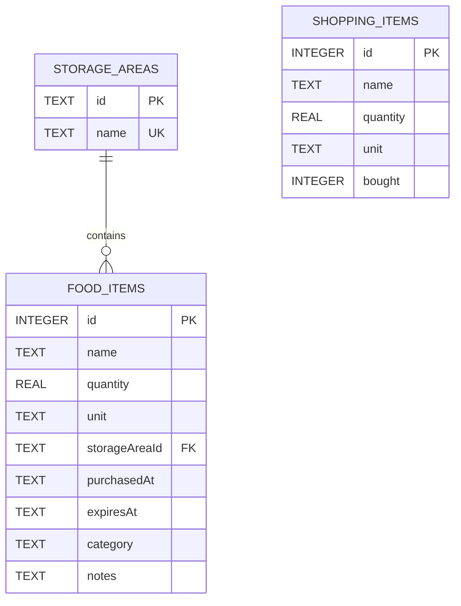

# Kế hoạch slide thuyết trình tuần 3 — FridgeChef

## Phạm vi trình bày

Thời lượng đề xuất: khoảng 7–8 phút, gồm 8 slide và demo ngay trong phần chức năng. Có thể điều chỉnh theo thời lượng thầy quy định.

Thông điệp chính: nhóm đã chuyển các luồng quản lý thực phẩm và đi chợ từ dữ liệu mẫu sang dữ liệu SQLite được lưu thật, tổ chức theo MVVM và có kiểm tra dữ liệu.

Không trình bày Supabase/Firebase hay đăng nhập thật như chức năng đã hoàn thành. Bản hiện tại là một tủ lạnh cục bộ trên thiết bị, màn đăng nhập chỉ là demo. Supabase là phương án đang cân nhắc cho giai đoạn trực tuyến.

## Kịch bản 8 slide

| Slide | Tiêu đề | Nội dung cần nói | Hình minh họa | Thời lượng |
|---|---|---|---|---|
| 1 | Mục tiêu tuần 3 | Bốn đầu việc: thiết kế dữ liệu, chọn lưu trữ, tổ chức kiến trúc, thực hiện CRUD | Một ảnh tủ lạnh đang có dữ liệu và tên đề tài | 30 giây |
| 2 | Mô hình dữ liệu — ERD | Ba bảng; storage_areas 1–N food_items; shopping_items là danh sách chờ mua độc lập | ERD, đánh dấu PK/FK | 60 giây |
| 3 | Lựa chọn SQLite và thiết kế trường | Lưu trên thiết bị; số lượng tách đơn vị; ngày ISO; ràng buộc; category/notes; migration giữ dữ liệu cũ | Bảng dữ liệu gọn và một ví dụ bản ghi | 50 giây |
| 4 | Kiến trúc MVVM | View hiển thị; ViewModel giữ state/xử lý; Model kiểm tra; Repository đọc/ghi SQL; dữ liệu chung giữa các màn hình | Sơ đồ kiến trúc và các thư mục tương ứng | 60 giây |
| 5 | Luồng xử lý CRUD | Nhập → kiểm tra → repository → SQLite → nạp lại danh sách; sửa/xóa theo id; xử lý lỗi trước thông báo thành công | Luồng thêm thực phẩm và ảnh form mới | 45 giây |
| 6 | Demo quản lý thực phẩm và đi chợ | Thêm/sửa/đọc lại/xóa; chọn ngăn và hạn riêng khi cất các món đã mua | Demo trực tiếp trên Android Emulator | 100 giây |
| 7 | Kiểm thử và kết quả | 25 test tự động đạt; bundle JavaScript Android đạt; kiểm thử lưu qua lần mở DB, FK, rollback và hạn dùng riêng từng món | Ảnh kết quả npm test, bảng 3–4 trường hợp nổi bật | 40 giây |
| 8 | Giới hạn và hướng tiếp theo | SQLite chưa đồng bộ nhiều máy; đăng nhập còn demo; cân nhắc Supabase Auth + PostgreSQL + phân quyền; AI/API chưa tích hợp | Hai cột: Đã hoàn thành / Tiếp theo | 35 giây |

Tổng nội dung khoảng 7 phút, dành thêm tối đa 1 phút cho chuyển màn hình và thao tác demo. Để rút còn 5 phút: gộp slide 2–3, rút demo còn 60 giây và chỉ trình bày 3 trường hợp kiểm thử.

## Chi tiết ERD cần đưa lên slide 2

Lưu ý khi nói: chuyển từ đi chợ sang tủ lạnh là một thao tác nghiệp vụ trong transaction, không phải một quan hệ khóa ngoại giữa hai bảng. Từng bảng thực phẩm/đi chợ còn có createdAt và updatedAt; có thể lược khỏi hình để dễ đọc.

## Các trường đáng giải thích trên slide 3

| Quyết định | Lý do / ví dụ |
|---|---|
| quantity REAL và unit TEXT | 0,5 kg hoặc 500 g; xử lý số lượng riêng với cách hiển thị |
| purchasedAt / expiresAt dạng YYYY-MM-DD | Là ngày lịch, so sánh và sắp xếp đúng; giao diện dùng lịch và hiển thị dd/MM/yyyy |
| storageAreaId là FK | Thực phẩm chỉ thuộc một ngăn hợp lệ |
| Không lưu trạng thái hết hạn cố định | Tính lại theo ngày hiện tại, tránh trạng thái cũ khi sang ngày mới |
| category / notes tùy chọn | Lưu thêm nhóm thực phẩm và ghi chú; schema v2 nâng cấp từ v1 bằng ALTER TABLE |
| SQL có tham số và transaction | Không nối dữ liệu nhập vào câu SQL; chuyển món thành công toàn bộ hoặc rollback |

## Các tệp minh chứng cho slide 4–5

| Thành phần | Tệp cần mở khi thầy hỏi |
|---|---|
| View | src/screens/fridge/AddFoodScreen.js; src/screens/shopping/ShoppingListScreen.js |
| Điều khiển tương tác dùng chung | src/components/FoodInputControls.js |
| ViewModel | src/viewmodels/FridgeProvider.js; useFoodFormViewModel.js; useShoppingViewModel.js |
| Model | src/models/food.js; src/models/foodForm.js |
| Repository | src/repositories/fridgeRepository.js |
| Schema / migration | src/database/schema.js |
| Test | tests/database.test.cjs; tests/food.test.cjs; tests/food-form.test.cjs |

Trên slide chỉ ghi tên tầng và trách nhiệm; không dán nguyên màn hình code dài. Khi cần minh chứng thì mở một hàm cụ thể.

## Kịch bản demo slide 6

1. Mở tủ lạnh và ghi nhận số lượng hiện tại, không xóa dữ liệu đang có để chuẩn bị demo.
2. Thêm một thực phẩm có tên dễ nhận biết như “Trứng demo”, số lượng 2 quả, ngày mua hôm nay, hạn sau 5 ngày.
3. Mở chi tiết, sửa thành 3 quả. Chỉ ra danh sách và thống kê đã cập nhật.
4. Tải lại toàn bộ app hoặc đóng/mở lại trên cùng máy ảo; kiểm tra bản ghi còn nguyên. Giữ phiên Expo chạy và không gỡ Expo Go.
5. Xóa riêng bản ghi demo vừa tạo, kiểm tra danh sách đã cập nhật.
6. Sang đi chợ: thêm 2 món demo, tích đã mua, cất với hai ngăn/hạn dùng khác nhau. Nếu ít thời gian, chuẩn bị sẵn danh sách và chỉ thao tác bước cất.
7. Mở tủ lạnh và chỉ ra ngăn, số lượng thực mua, hạn dùng của từng món được giữ đúng.

Nếu mạng hoặc trình chiếu trục trặc, dùng ảnh chụp trước/sau làm phương án dự phòng, ghi rõ đó là ảnh minh họa thay vì giả làm demo trực tiếp.

## Kiểm thử cần chọn cho slide 7

- Lưu, sửa, đóng/mở DB và dữ liệu vẫn còn; dữ liệu đã xóa không tự quay lại.
- Số lượng 0, tên rỗng hoặc thiếu hạn dùng bị từ chối.
- Hai món mua có ngăn/hạn dùng khác nhau được lưu riêng chính xác.
- Một món lỗi trong batch chuyển: không mất món đi chợ và không có thực phẩm được lưu dở dang.

Phân biệt bằng chứng: 25 test chạy trên SQLite của Node và mã nguồn model/repository thật; bundle Android kiểm tra việc đóng gói JavaScript. Hai kết quả này không thay thế kiểm tra giao diện, bàn phím và vùng chạm trên máy ảo/điện thoại.

## Chuẩn bị trước khi làm slide chính thức

- Chụp màn tủ lạnh có dữ liệu, form thực phẩm, danh sách đi chợ và bước cất món.
- Chuẩn bị ảnh kết quả npm test và kiểm tra lại demo trên máy ảo.
- Xác nhận thời lượng được trình bày và danh sách thành viên để chia phần nói.
- Giữ phong cách xanh của FridgeChef; mỗi slide một ý chính, ERD và kiến trúc ưu tiên hình lớn, chữ ngắn.
- Bổ sung tên nhóm, lớp và phân công thực tế; không suy đoán thành viên hoặc phần việc chưa xác nhận.
